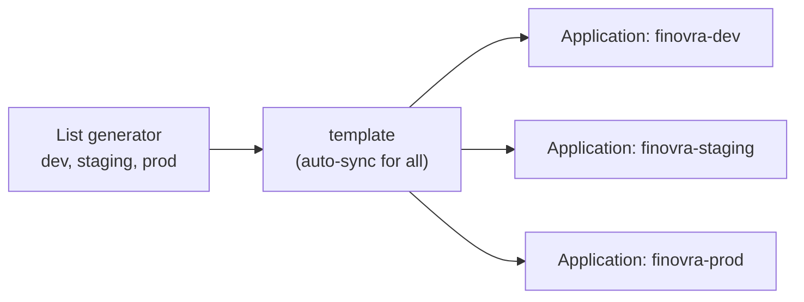

# Module 8b: Environment Applications → One ApplicationSet

**Environment:** `kind` (local)
**Prerequisites:** Module 8 complete — you understand `generators`/`template` and the List generator

---

## Why This Module Exists

Module 8's lab generated one `Application` per **backend service** (`finovra-services`), deliberately kept separate from the three real per-environment `Application`s (`finovra`, `finovra-staging`, `finovra-prod`) so nothing would collide.

This module replaces those three hand-written `Application` files with a single **`ApplicationSet`** — the exact pattern Module 8, Section 2 showed but told you not to apply for real, because back then it would have collided with the `Application`s you'd already hand-created. Now those hand-written files are gone, so applying it for real is safe.

By the end you'll have:
- `apps/finovra-environments.yaml` — one `ApplicationSet` generating all three: `finovra-dev`, `finovra-staging`, `finovra-prod` — all auto-synced (`prune: true`, `selfHeal: true`).
- `apps/finovra.yaml`, `apps/finovra-staging.yaml`, `apps/finovra-prod.yaml` — all deleted. Their job is now done by the generator's `elements:` list, not by three separate hand-maintained files.

---

## 1. One Generator, One Template, Three Environments

Each environment differs from the others in exactly two fields — `path` (where in the repo its manifests live) and `namespace` (where it deploys). That's precisely the List generator's sweet spot from Module 8: a small, fixed set of things, declared as data once instead of copy-pasted three times.



All three environments share one `syncPolicy` — `automated: { prune: true, selfHeal: true }` — so a push to `main` rolls out to dev, staging, and prod the same way, without a separate manual step for any of them.

---

## 2. A Note on Dev's Helm Values

Today's `apps/finovra.yaml` deploys the Helm chart with `helm.valueFiles: [values-dev.yaml]`. Check what that file actually overrides:

```yaml
# helm-chart/values-dev.yaml
dashboard:
  replicas: 3
```

```yaml
# helm-chart/values.yaml (defaults)
dashboard:
  replicas: 3
  ...
```

It's a no-op — `values-dev.yaml` sets `dashboard.replicas` to the exact value the chart's default already has. That's why the template below deploys `helm-chart` with **no `helm.valueFiles` block at all**: dropping it changes nothing about what gets deployed today, and it's what keeps the template uniform across all three environments (same shape, just `path` and `namespace` differ per element).

**If you later give `values-dev.yaml` a real override** (something that actually differs from `values.yaml`), this uniform template can no longer express it — a plain List generator's `{{ }}` placeholders only fill in scalar values, they can't switch a whole `helm:` block on for one element and off for the others. You'd need either a dedicated single-element `ApplicationSet` for dev, or `spec.goTemplate: true` with a conditional block. Worth knowing now, not surprising later.

---

## 3. Current State (Before)

```
apps/
├── root.yaml              # App-of-Apps, auto-syncs everything under apps/
├── finovra.yaml            # Application: dev   (helm-chart, auto-sync)
├── finovra-staging.yaml    # Application: staging (kustomize/overlays/staging, auto-sync)
├── finovra-prod.yaml       # Application: prod  (kustomize/overlays/prod)
└── finovra-services.yaml   # ApplicationSet from Module 8 (per-service, unrelated to this change)
```

## 4. Target State (After)

```
apps/
├── root.yaml                   # unchanged
├── finovra-environments.yaml   # ApplicationSet → finovra-dev, finovra-staging, finovra-prod (all auto-sync)
└── finovra-services.yaml       # unchanged, from Module 8
```

`finovra.yaml`, `finovra-staging.yaml`, and `finovra-prod.yaml` are all gone. Their content lives in `finovra-environments.yaml`'s generator `elements:` instead.

---

## 5. Why This Is Safe (No Downtime)

Deleting an `Application` object in ArgoCD does **not** delete the Kubernetes resources it manages, unless that `Application` carries the `resources-finalizer.argocd.argoproj.io` finalizer. None of `finovra.yaml`, `finovra-staging.yaml`, or `finovra-prod.yaml` have one — check `metadata:` in each file if you want to confirm yourself. So when `root.yaml` prunes the old `Application` objects:

- The `Deployment`s/`Service`s already running in the `finovra`, `finovra-staging`, `finovra-prod` namespaces **keep running**, now briefly unmanaged by any `Application`.
- The new `ApplicationSet`-generated `Application`s (`finovra-dev`, `finovra-staging`, `finovra-prod`) target the **same namespace and the same source path** as the ones they replace, so when they sync, they simply **adopt** the already-running resources instead of recreating them. Same `Deployment` names, same `Service` names, same namespace — nothing to reconcile away.

One exception worth flagging: dev's `Application` is renamed from `finovra` to `finovra-dev` (matching the `{{env}}` template pattern used for all three). This is a rename of the `Application` object only — the underlying `Deployment`s/`Service`s in the `finovra` namespace are untouched and get adopted the same way. `staging` and `prod` keep their existing names (`finovra-staging`, `finovra-prod`), so nothing is renamed for them at all.

---

## 6. Trade-off Worth Knowing: No Manual Gate on Prod

With `syncPolicy.automated` shared across all three elements, a push to `main` that touches `kustomize/overlays/prod/` rolls out to prod the same way it rolls out to dev and staging — automatically, no approval step in ArgoCD itself. That's the trade you're making here in exchange for one simple file instead of two.

If you want a human checkpoint before prod changes, it now has to live **before** the push — e.g. a required PR review/approval on `kustomize/overlays/prod/` in the `gitops` repo, or a promotion step like the one Module 7 covered, rather than inside the `ApplicationSet` itself. ArgoCD is still the thing making prod match git; the question of *when* git is allowed to change is now entirely a Git-hosting concern (branch protection, CODEOWNERS, required reviewers), not an ArgoCD one.

---

## Lab: Migrate to a Single ApplicationSet

All of this happens in your fork of `gitops`.

### Step 1 — Write `apps/finovra-environments.yaml`

```yaml
apiVersion: argoproj.io/v1alpha1
kind: ApplicationSet
metadata:
  name: finovra-environments
  namespace: argocd
spec:
  generators:
    - list:
        elements:
          - env: dev
            path: helm-chart
            namespace: finovra
          - env: staging
            path: kustomize/overlays/staging
            namespace: finovra-staging
          - env: prod
            path: kustomize/overlays/prod
            namespace: finovra-prod
  template:
    metadata:
      name: 'finovra-{{env}}'
    spec:
      project: default
      source:
        repoURL: https://github.com/finovra-app/gitops.git
        targetRevision: main
        path: '{{path}}'
      destination:
        server: https://kubernetes.default.svc
        namespace: '{{namespace}}'
      syncPolicy:
        automated:
          prune: true
          selfHeal: true
        syncOptions:
          - CreateNamespace=true
```

### Step 2 — Delete the old per-environment `Application` files

```bash
git rm apps/finovra.yaml apps/finovra-staging.yaml apps/finovra-prod.yaml
```

### Step 3 — Preview before pushing

```bash
argocd appset generate apps/finovra-environments.yaml
```

Confirm it renders exactly three `Application`s — `finovra-dev` (namespace `finovra`, source `helm-chart`), `finovra-staging` (namespace `finovra-staging`, source `kustomize/overlays/staging`), and `finovra-prod` (namespace `finovra-prod`, source `kustomize/overlays/prod`) — each with the same `syncPolicy.automated` block.

### Step 4 — Commit and push

```bash
git add apps/finovra-environments.yaml
git commit -m "Replace per-environment Applications with a single ApplicationSet"
git push origin main
```

### Step 5 — Let root sync, then verify

`root.yaml` auto-syncs on its own poll interval, or force it immediately:

```bash
argocd app sync finovra-root
argocd app list
```

You should see `finovra-dev`, `finovra-staging`, and `finovra-prod` all reach `Synced`/`Healthy` on their own within moments — no manual step for any of them.

```bash
kubectl get pods -n finovra -n finovra-staging -n finovra-prod
```

Confirm pods keep running throughout — this is the adoption behavior from Section 5, not a redeploy.

### Step 6 — Prove it reacts the same way in every environment

Make a trivial change under `kustomize/overlays/prod/` (e.g. bump a replica count or image tag comment), push it, and watch:

```bash
argocd app get finovra-prod
```

It should self-heal to `Synced` on its own, the same way `finovra-staging` would for an equivalent change under `kustomize/overlays/staging/` — no `argocd app sync` needed for either.

---

## Key Terms Glossary

| Term | Meaning |
|---|---|
| **Adoption** | When a new `Application` targets a namespace/resources an old (now-deleted) `Application` already created — ArgoCD reconciles against what's already running instead of recreating it, as long as neither had the cascading-delete finalizer |
| **`resources-finalizer.argocd.argoproj.io`** | The finalizer that makes deleting an `Application` also delete everything it deployed. None of this repo's `Application`s carry it, which is why deleting old `Application` files here doesn't take workloads down |
| **Shared `syncPolicy`** | Every `Application` a List generator produces from one `template` inherits the same `syncPolicy` — there's no per-element override without `goTemplate: true` and a conditional |

---

## Recap Questions

1. Why is it safe to apply this single `ApplicationSet` for real now, when Module 8, Section 2 explicitly said not to apply the equivalent example?
2. What specifically in an `Application`'s YAML determines whether deleting it also deletes the resources it deployed — and do any of this repo's `Application`s have it?
3. `values-dev.yaml` was dropped from the template entirely. Why was that safe to do today, and what would make it unsafe in the future?
4. Since ArgoCD no longer gates prod changes with a manual sync, where does Section 6 say the approval checkpoint should live instead?
5. If a fourth environment (say, `qa`) needed the exact same treatment as `dev`/`staging`/`prod`, what's the smallest change that would deploy it?
