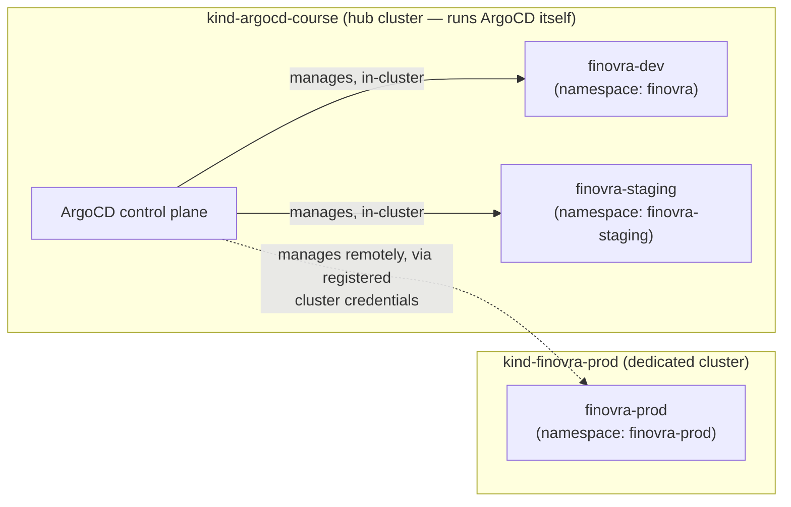

# Module 9: Multi-Cluster Basics

**Environment:** `kind` (local)
**Prerequisites:** Module 8 complete — `finovra-dev`/`finovra-staging`/`finovra-prod` all generated by one `ApplicationSet`, all `Synced`/`Healthy` on the same `kind` cluster

---

## Learning Objectives

By the end of this module, you should be able to:
- Explain why real teams often give prod its own cluster instead of just its own namespace
- Register an external `kind` cluster with ArgoCD using `argocd cluster add`
- Explain the one `kind`-specific networking gotcha that trips up almost everyone the first time they register a second local cluster
- Point one environment in an existing `ApplicationSet` at a different cluster using `destination.name`
- Explain why changing an `Application`'s destination doesn't move its resources — and what you have to do yourself as a result

---

## 1. Why a Second Cluster, Not Just a Second Namespace

Every environment so far — `finovra` (dev), `finovra-staging`, `finovra-prod` — has lived on the same `kind` cluster, separated only by namespace. That's been fine for this course, and it's genuinely fine for a lot of real teams too, especially smaller ones. But it has real limits:

- **Blast radius.** A misbehaving pod that exhausts node CPU/memory, or a cluster-level outage (etcd, the control plane, a bad CNI upgrade), takes down every namespace on that cluster — dev, staging, *and* prod — at once. Namespaces isolate Kubernetes objects from each other; they don't isolate the underlying nodes.
- **Blast radius of access.** Anyone with `kubectl` access to the cluster can, by default, see or touch every namespace on it unless RBAC is carefully scoped per-namespace. A separate cluster is a much harder boundary to cross by accident.
- **Noisy neighbors.** Non-prod workloads (a broken canary, a load test, a debugging session) compete for the same node capacity as prod, on the same cluster.

This is why "prod gets its own cluster" is one of the most common real-world splits — sometimes it's "non-prod cluster + prod cluster" (what this module builds: dev and staging stay together, prod moves out), sometimes it's "staging cluster + prod cluster" with dev on developers' own local clusters. Either way, the mechanism is identical: register a second cluster with ArgoCD, then point one environment's `Application` at it instead of at `https://kubernetes.default.svc`.



Nothing changes about *how* you deploy — same repo, same `ApplicationSet`, same Git-push-to-deploy workflow. What changes is *where* — and ArgoCD was built to manage exactly this from one control plane.

---

## 2. Registering a Cluster with ArgoCD

`argocd cluster add <context>` is how you tell ArgoCD about a second cluster. It does three things, all in one command:

1. Reads the named context from your local kubeconfig to find the target cluster's API server and credentials.
2. Creates a `ServiceAccount` (default name `argocd-manager`) and a `ClusterRoleBinding` granting it `cluster-admin` **on the target cluster** — this is what lets ArgoCD, running on the hub cluster, actually apply resources to a cluster it isn't running on.
3. Stores the target cluster's API server URL and that service account's token as a `Secret` in the `argocd` namespace **on the hub cluster** — this is what shows up when you run `argocd cluster list`.

```bash
argocd cluster add kind-finovra-prod --name finovra-prod-cluster
argocd cluster list
```

Once registered, any `Application` or `ApplicationSet` template can target it via `destination.name: finovra-prod-cluster` instead of a raw server URL — no need to hardcode or remember the actual API server address anywhere in Git.

---

## 3. The `kind`-Specific Gotcha: Internal vs. External Addresses

Here's the part that trips up almost everyone doing this with two local `kind` clusters for the first time, so it's worth understanding *before* you hit it rather than debugging it blind.

When you run `kind create cluster --name finovra-prod`, `kind` merges a new context into your kubeconfig with a server address like `https://127.0.0.1:54321` — a port on your **host machine**, forwarded into the cluster's control-plane container. That address works fine when *you* run `kubectl` from your laptop.

It does **not** work for ArgoCD. ArgoCD's pods run *inside* the first `kind` cluster's control-plane container, on Docker's internal `kind` network — not on your host. From inside that container, `127.0.0.1` means "this container," not "your laptop." If you register the cluster using the default host-facing kubeconfig, `argocd cluster add` will appear to succeed, but `argocd cluster list` will show the new cluster stuck in an unreachable/unknown state, and any `Application` targeting it will fail to sync with a connection error.

The fix: `kind` can export a kubeconfig using the **internal** Docker-network address instead — the one other containers on the same `kind` network (like ArgoCD's pods) can actually reach:

```bash
kind export kubeconfig --name finovra-prod --internal --kubeconfig ./finovra-prod-internal.kubeconfig
```

Use *that* file — not your default kubeconfig — for the `argocd cluster add` step. Your default kubeconfig (and `kubectl --context kind-finovra-prod` from your host) is untouched and keeps working normally throughout this module; the internal-address file exists purely so ArgoCD can reach the cluster.

---

## 4. `destination.name` vs. `destination.server`

Every `Application` so far has used `destination.server: https://kubernetes.default.svc` — the literal, well-known API server address of whatever cluster ArgoCD itself is running in. ArgoCD also lets you reference a registered cluster by a **friendly name** instead: `destination.name: <name>`.

ArgoCD reserves one name automatically, no registration needed: **`in-cluster`** always means "the cluster ArgoCD itself is running on" — the same target `https://kubernetes.default.svc` points at. That means you can switch *every* environment in the `ApplicationSet`'s template to use `destination.name` uniformly — `in-cluster` for dev/staging, `finovra-prod-cluster` for prod — instead of mixing a hardcoded URL with a friendly name. One field, one placeholder, works for all three:

```yaml
destination:
  name: '{{cluster}}'
  namespace: '{{namespace}}'
```

with each list element supplying its own `cluster: in-cluster` or `cluster: finovra-prod-cluster`.

---

## 5. Moving Prod, Not Copying It — the Cleanup Step

There's one thing worth being explicit about before you do this for real: **changing an `Application`'s destination in Git does not move its existing resources.** ArgoCD's prune/self-heal logic only ever reconciles against the destination currently declared for that `Application`. The moment `finovra-prod`'s destination changes from the hub cluster to `finovra-prod-cluster`, ArgoCD:

- Creates `finovra-prod`'s `Deployment`s/`Service`s fresh on the **new** cluster, in the `finovra-prod` namespace there.
- Has **no further opinion** about the `finovra-prod` namespace and everything in it that's still sitting on the **old** (hub) cluster — those resources are simply no longer part of any `Application`'s tracked state. They don't get pruned automatically, because pruning only ever compares Git against the *current* destination, and the old cluster isn't that destination anymore.

So after the switch, the old namespace is orphaned but still running — you have to clean it up yourself:

```bash
kubectl --context kind-argocd-course delete namespace finovra-prod
```

This is the same "no finalizer means no cascading delete" mechanic from Module 8, just triggered by a destination change instead of a deleted `Application` file — and this time it's on you to run the cleanup, since ArgoCD genuinely has no way to know the old copy should go.

---

## Lab: Give Prod Its Own Cluster

All of this happens in your fork of `gitops`, alongside your existing `kind-config.yaml`.

### Step 1 — Create a config for the second cluster

Create `kind-config-prod.yaml` next to your existing `kind-config.yaml`:

```yaml
kind: Cluster
apiVersion: kind.x-k8s.io/v1alpha4
name: finovra-prod
nodes:
  - role: control-plane
  - role: worker
```

No `extraPortMappings` needed here — this cluster only runs application workloads; ArgoCD itself keeps running on your original `kind-argocd-course` cluster.

### Step 2 — Spin up the second cluster

```bash
kind create cluster --config kind-config-prod.yaml
kubectl config get-contexts
```

Confirm you now see two contexts: `kind-argocd-course` (your original, still current) and `kind-finovra-prod` (new).

### Step 3 — Export an internal-address kubeconfig and register the cluster

```bash
kind export kubeconfig --name finovra-prod --internal --kubeconfig ./finovra-prod-internal.kubeconfig
argocd cluster add kind-finovra-prod --kubeconfig ./finovra-prod-internal.kubeconfig --name finovra-prod-cluster
```

You'll be shown the `ServiceAccount`/`ClusterRoleBinding` `argocd cluster add` is about to create on `finovra-prod` and asked to confirm — say yes.

### Step 4 — Confirm registration

```bash
argocd cluster list
```

Confirm you see two entries: the local `in-cluster` one (`https://kubernetes.default.svc`) and the new `finovra-prod-cluster` one, with a `STATUS` of `Successful` and a `SERVER` address that looks like `https://finovra-prod-control-plane:6443` — the internal address from Step 3, **not** a `127.0.0.1:*` address. If you see `127.0.0.1` here, you registered the wrong kubeconfig — re-run Step 3.

### Step 5 — Point prod at the new cluster

Edit `apps/finovra-environments.yaml` — add a `cluster` field to each element, and switch `destination` from `server` to `name`:

```yaml
apiVersion: argoproj.io/v1alpha1
kind: ApplicationSet
metadata:
  name: finovra-environments
  namespace: argocd
spec:
  generators:
    - list:
        elements:
          - env: dev
            path: helm-chart
            namespace: finovra
            cluster: in-cluster
          - env: staging
            path: kustomize/overlays/staging
            namespace: finovra-staging
            cluster: in-cluster
          - env: prod
            path: kustomize/overlays/prod
            namespace: finovra-prod
            cluster: finovra-prod-cluster
  template:
    metadata:
      name: 'finovra-{{env}}'
    spec:
      project: default
      source:
        repoURL: https://github.com/finovra-app/gitops.git
        targetRevision: main
        path: '{{path}}'
      destination:
        name: '{{cluster}}'
        namespace: '{{namespace}}'
      syncPolicy:
        automated:
          prune: true
          selfHeal: true
        syncOptions:
          - CreateNamespace=true
```

Preview before pushing:

```bash
argocd appset generate apps/finovra-environments.yaml
```

Confirm `finovra-dev` and `finovra-staging` still show `destination.name: in-cluster`, and `finovra-prod` now shows `destination.name: finovra-prod-cluster`.

### Step 6 — Commit and push

```bash
git add apps/finovra-environments.yaml
git commit -m "Move prod to its own dedicated kind cluster"
git push origin main
```

### Step 7 — Watch it land on the new cluster

```bash
argocd app sync finovra-root
argocd app get finovra-prod
```

Confirm `finovra-prod`'s destination now shows `finovra-prod-cluster`, and it reaches `Synced`/`Healthy`:

```bash
kubectl --context kind-finovra-prod get pods -n finovra-prod
```

### Step 8 — Clean up the orphaned copy on the hub cluster

As covered in Section 5, the old `finovra-prod` namespace is still sitting on the original cluster, unmanaged:

```bash
kubectl --context kind-argocd-course get namespace finovra-prod
```

Confirm it's still there, then remove it:

```bash
kubectl --context kind-argocd-course delete namespace finovra-prod
kubectl --context kind-argocd-course get namespace finovra-prod
```

**Checkpoint:** the last command returns `NotFound` — prod's old copy is gone from the hub cluster, and the only running copy of prod lives on `finovra-prod-cluster`, still deployed and kept in sync through the exact same Git push you'd use for dev or staging.

---

## Key Terms Glossary

| Term | Meaning |
|---|---|
| **Hub cluster** | The cluster ArgoCD itself runs on — `kind-argocd-course` throughout this course |
| **`argocd cluster add`** | Registers an external cluster with ArgoCD: creates a `cluster-admin` `ServiceAccount` on the target, stores its address/credentials as a `Secret` on the hub |
| **Internal vs. external address** | `kind`'s default kubeconfig uses a host-facing `127.0.0.1:<port>` address; `kind export kubeconfig --internal` produces one using the Docker-network address other containers (like ArgoCD's pods) can actually reach |
| **`destination.name`** | References a registered cluster by friendly name instead of a raw API server URL; `in-cluster` is reserved automatically for the cluster ArgoCD runs on, no registration needed |
| **Destination change ≠ resource move** | Editing an `Application`'s destination makes ArgoCD create resources fresh at the new destination — it does not delete the old copy at the previous destination, since pruning only ever compares Git against the *current* destination |

---

## Recap Questions

1. Why does `argocd cluster add` fail (or register an unreachable cluster) if you point it at the default kubeconfig instead of one exported with `--internal`?
2. What two things does `argocd cluster add` create on the *target* cluster, and what one thing does it create on the *hub* cluster?
3. Why is `in-cluster` usable in `destination.name` without ever running `argocd cluster add` for it?
4. After Step 7, `finovra-prod` is `Synced`/`Healthy` on the new cluster — why is the old `finovra-prod` namespace on the hub cluster still running at that point, and whose job is it to remove it?
5. If you wanted `finovra-staging` to move to its own dedicated cluster too, what's the smallest change to `apps/finovra-environments.yaml` that would do it?

---

## What's Next

In **Module 10**, we leave `kind` behind and provision a real cluster in AWS — EKS via Terraform — and install ArgoCD on it the same way you did locally in Module 2, this time on infrastructure you define, version, and can tear down on demand.
